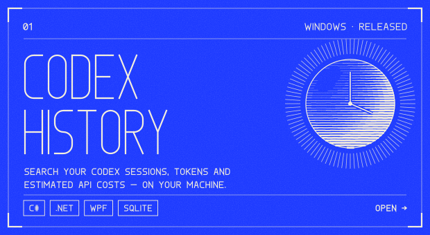
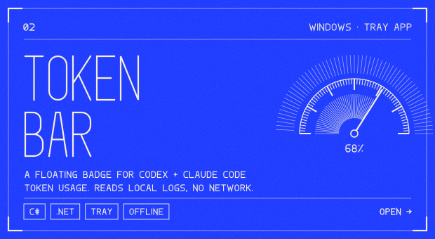
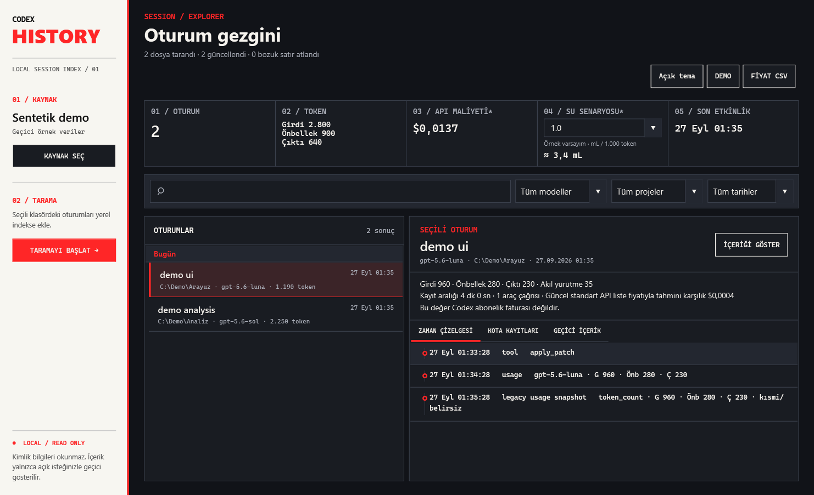

I'm Cemil, a computer engineering student. I build **local tools for AI-assisted work**: small Windows apps that read the data already on your machine and turn it into something you can use. They run offline and don't need an API key or an account.

**Now:** fixing bugs upstream in the agent and MCP projects I use every day, and shipping updates to the two apps below.

  
  

<table>
  <tr>
    <td width="50%" valign="top">
      
       <a href="https://github.com/Cemilcanoz/codex-history/releases/latest"><b>Download for Windows</b></a> · <a href="https://github.com/Cemilcanoz/codex-history">Source</a> · <a href="https://github.com/Cemilcanoz/codex-history/actions">CI</a>
    </td>
    <td width="50%" valign="top" align="center">
      
       <a href="https://github.com/Cemilcanoz/tokenbar">Source &amp; docs</a> · Codex CLI + Claude Code · numbers are examples
    </td>
  </tr>
</table>

### Open source, in review

| Project | Pull request |
|---|---|
| [NousResearch/hermes-agent](https://github.com/NousResearch/hermes-agent) | [Exclude pinned skills from curator review](https://github.com/NousResearch/hermes-agent/pull/146141) · [null model names in TUI picker](https://github.com/NousResearch/hermes-agent/pull/146560) · [null cron history](https://github.com/NousResearch/hermes-agent/pull/146554) · [quiet email lease notices](https://github.com/NousResearch/hermes-agent/pull/146520) · [kanban diagnostics task id](https://github.com/NousResearch/hermes-agent/pull/157111) |
| [BerriAI/litellm](https://github.com/BerriAI/litellm) | [Session tokens in MCP OAuth exchange](https://github.com/BerriAI/litellm/pull/51042) · [Persist cleared OAuth2 scopes](https://github.com/BerriAI/litellm/pull/52018) |
| [openai/openai-cookbook](https://github.com/openai/openai-cookbook) | [Turkish document retrieval eval](https://github.com/openai/openai-cookbook/pull/3144) · [UTF-8 request files](https://github.com/openai/openai-cookbook/pull/3173) |

### Smaller experiments

- **[t](https://github.com/Cemilcanoz/t)**: select any part of the screen and translate it. Windows OCR, PySide6, no API key.
- **[hafiza-duvar-kagidi](https://github.com/Cemilcanoz/hafiza-duvar-kagidi)**: an Obsidian link graph as a live Windows wallpaper (WebView2).
- **[uzay-benchmark](https://github.com/Cemilcanoz/uzay-benchmark)**: five models build the same 3D N-body simulation, compared side by side.
- **[Palet](https://github.com/Cemilcanoz/Palet-Fiziksel-Renk-Kar-m-St-dyosu)**: mixing colors as solids, liquids and gas, with live HEX/RGB values.

**Stack:** C# · .NET · WPF · SQLite · Python · JavaScript, and some Kotlin / Jetpack Compose.
**Writing:** notes on software, AI and networks on [Medium](https://medium.com/@cemilcanoz15) (TR / EN) · [LinkedIn](https://www.linkedin.com/in/cemil-can-%C3%B6z-3181282a6)

Header and cards are generated by <a href="scripts/build_svgs.py"><code>scripts/build_svgs.py</code></a> from a hand-drawn stroke alphabet. They use no web fonts.
