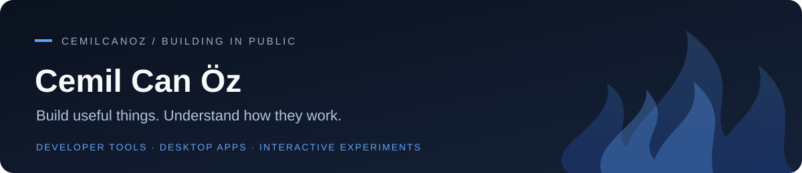

I'm a computer engineering student building tools I want to use — mostly Windows developer tools, interactive web experiments and small applications that make an everyday task easier.

**Currently building:** [Codex History](https://github.com/Cemilcanoz/codex-history), a local way to explore coding sessions, token usage and estimated API costs.

[Projects](https://github.com/Cemilcanoz?tab=repositories) · [Writing / Medium](https://medium.com/@cemilcanoz15) · [Latest release](https://github.com/Cemilcanoz/codex-history/releases/latest) · [LinkedIn](https://www.linkedin.com/in/cemil-can-%C3%B6z-3181282a6)

## Featured work

### [Codex History](https://github.com/Cemilcanoz/codex-history)

A Windows companion for revisiting Codex sessions. Search your history, inspect usage and keep the index on your machine. Built with **C# / .NET, WPF and SQLite**.

[Download for Windows](https://github.com/Cemilcanoz/codex-history/releases/latest) · [Source & documentation](https://github.com/Cemilcanoz/codex-history) · [Build & tests](https://github.com/Cemilcanoz/codex-history/actions)

| Project | What I explored |
|---|---|
| [Palet](https://github.com/Cemilcanoz/Palet-Fiziksel-Renk-Kar-m-St-dyosu) | An interactive color-mixing playground with live HEX/RGB values. JavaScript. |
| [Network Architecture Visualizer](https://github.com/Cemilcanoz/network-mimarisi-animasyonu-P2P-vs-Client-Server-Python-tkinter) | Making peer-to-peer and client-server networks easier to understand through animation. Python / Tkinter. |

## Writing

I share what I learn about software, AI and computer networks on [Medium](https://medium.com/@cemilcanoz15), with articles in Turkish and English.

## What I work with

**C# · .NET · WPF · SQLite · Python · JavaScript**

Also exploring Kotlin / Jetpack Compose and applied machine learning through smaller projects. I like local tools, interfaces that explain their data, and experiments I can test and improve.

---

Türkçe / English · Feel free to explore a project, open an issue or suggest an improvement.
